# Phone Controller Games

<p align="center">
  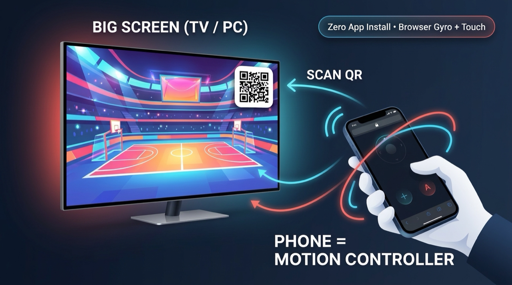
</p>

<!-- LIVE-LINK:START -->
<p align="center">
  <a href="https://phone-controller-games.pages.dev/"></a>
</p>
<!-- LIVE-LINK:END -->

**Turn any smartphone into a wireless motion & touch controller for big-screen 3D multiplayer games.**  
No app install required — open the game on a TV or laptop, scan the QR code with your phone browser, and play together.

---

## How It Works

1. **Open on a Big Screen** — Visit [**phone-controller-games.pages.dev**](https://phone-controller-games.pages.dev/) on your TV, monitor, or laptop and pick a game.
2. **Scan the QR Code** — Point your phone camera at the screen QR code to join the room instantly in your mobile browser.
3. **Play with Motion & Touch** — Your phone streams gyroscope/accelerometer & touch input at ~60Hz while the big screen renders the 3D action for **1–4 players** (up to **8 players** in Fishing, Zombie Gun, and Tug of War).

> **Note:** Game servers run on free Render instances and sleep when idle; first load may take ~30–60 seconds to wake up.

---

## Games (16 Titles)

<table>
  <tr>
    <td width="50%" valign="top">
      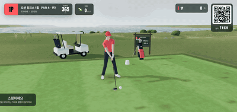<br>
      <strong>Golf</strong> (<code>/golf/</code>) • 1–4P<br>
      3-hole courses, Near-Pin, and Putting Challenge. Hold your phone like a club, press Address, and swing.
    </td>
    <td width="50%" valign="top">
      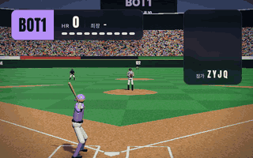<br>
      <strong>Baseball: Home Run Derby & Duel</strong> (<code>/baseball/</code>) • 1–4P<br>
      Swing for the fences or face off 1v1 pitcher vs. batter (fastball, slider, curve, forkball).
    </td>
  </tr>
  <tr>
    <td width="50%" valign="top">
      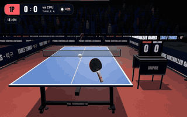<br>
      <strong>Ping Pong</strong> (<code>/pingpong/</code>) • 1–4P<br>
      Split-screen first-person table tennis with slow-mo timing rings, drives, cuts, and side spin.
    </td>
    <td width="50%" valign="top">
      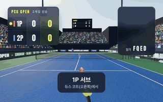<br>
      <strong>Tennis</strong> (<code>/tennis/</code>) • 1–4P<br>
      Singles or 2v2 doubles. Auto-positioning lets you focus on forehand/backhand topspin and slices.
    </td>
  </tr>
  <tr>
    <td width="50%" valign="top">
      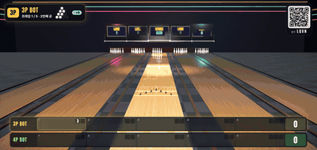<br>
      <strong>Bowl Night</strong> (<code>/bowling/</code>) • 1–4P<br>
      Ten-pin bowling with custom pin physics, wrist-twist hook curves, and 5/10-frame modes.
    </td>
    <td width="50%" valign="top">
      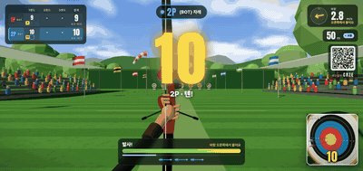<br>
      <strong>Archery</strong> (<code>/archery/</code>) • 1–4P<br>
      Aim with your phone gyro, pull back the bowstring on-screen, and compensate for wind & heartbeat sway.
    </td>
  </tr>
  <tr>
    <td width="50%" valign="top">
      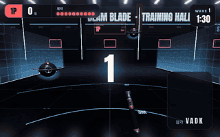<br>
      <strong>Beam Blade</strong> (<code>/saber/</code>) • 1–4P<br>
      Deflect and reflect incoming drone blaster bolts with a 1:1 gyro-tracked lightsaber and phone audio.
    </td>
    <td width="50%" valign="top">
      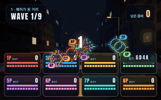<br>
      <strong>Zombie Gun Arcade</strong> (<code>/gun/</code>) • 1–8P<br>
      Point-and-shoot gyro light-gun co-op against waves of zombies; shake or tap to reload.
    </td>
  </tr>
  <tr>
    <td width="50%" valign="top">
      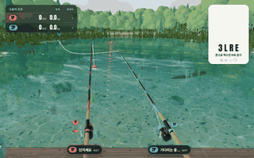<br>
      <strong>Bass Fishing</strong> (<code>/fishing/</code>) • 1–8P<br>
      Drop-in lake fishing with no lobby timer — cast, wait for the bite haptic, hookset, and reel in.
    </td>
    <td width="50%" valign="top">
      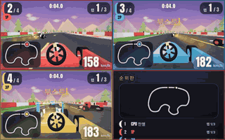<br>
      <strong>Kart Race</strong> (<code>/kart/</code>) • 1–4P<br>
      Tilt your phone like a steering wheel to drift around the track and fire items.
    </td>
  </tr>
  <tr>
    <td width="50%" valign="top">
      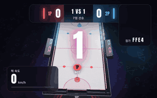<br>
      <strong>Air Hockey</strong> (<code>/airhockey/</code>) • 1–4P<br>
      Drag your phone screen as a low-latency touch mallet in 1v1 or 2v2 arcade matches.
    </td>
    <td width="50%" valign="top">
      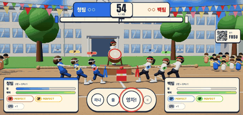<br>
      <strong>Tug of War</strong> (<code>/tugofwar/</code>) • 1–8P<br>
      Team rhythm-pulling battle — yank in sync with the chant for team combo bonuses.
    </td>
  </tr>
  <tr>
    <td width="50%" valign="top">
      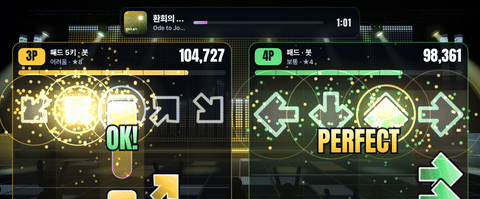<br>
      <strong>Rhythm Step</strong> (<code>/rhythm/</code>) • 1–4P<br>
      Motion & tap rhythm action synced to BPM tracks with real-time judgment feedback.
    </td>
    <td width="50%" valign="top">
      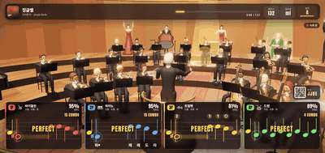<br>
      <strong>Orchestra</strong> (<code>/orchestra/</code>) • 1–4P<br>
      Perform different instruments together in a 3D concert hall following the conductor's tempo.
    </td>
  </tr>
  <tr>
    <td width="50%" valign="top">
      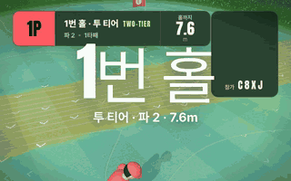<br>
      <strong>Putting Challenge</strong> (<code>/putting/</code>) • 1–4P<br>
      Dedicated 3-hole sloped green putting mode with pendulum stroke speed sensing.
    </td>
    <td width="50%" valign="top">
      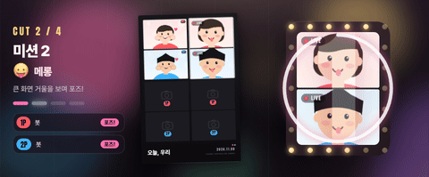<br>
      <strong>Photo Booth</strong> (<code>/photobooth/</code>) • 1–4P<br>
      4-cut party photo booth controlled from phones with live drawing, stickers, and instant download.
    </td>
  </tr>
</table>

---

## Architecture

- **Relay Server (`server.js`)**: Lightweight Node.js + WebSocket server managing 4-letter room codes, 15s reconnect grace windows, QR join URLs, and volatile motion event relaying (all game physics & judgment run client-side).
- **Big Screen & Phone Views (`public/<game>/` & `public/play/<game>/`)**: Built with bundled `three` (3D rendering) and local fonts — zero external CDN dependencies.
- **Latency Compensation**: Both screens and phones measure RTT every 1.5s so swing/hit timestamps are normalized (`arrival - phoneRTT/2 - screenRTT/2 - sensorDelay`) without clock sync.

---

## Local Development & Testing

```bash
npm install
npm start        # Starts server at http://localhost:3000
npm test         # Runs room, relay, and game physics tests
```

- **Test without phones**: Append `?bots=N&autostart` to any big-screen URL to spawn bots and use keyboard controls.
- **Test without gyro sensors**: Mobile motion APIs require HTTPS (`DeviceOrientationEvent`); on desktop/HTTP, append `&debug` to phone URLs or use the built-in test-swing / touch fallback buttons.

---

## Deployment

- **Game Selector (Cloudflare Pages)**: `npm run build:selector` builds `dist-selector/` for [**phone-controller-games.pages.dev**](https://phone-controller-games.pages.dev/) and probes Render instances via `/api/load` to route players to the least busy server.
- **Game Servers (Render)**: Configured via `render.yaml` / `render-replica.yaml` (Node 22, auto-deploy on `main`).
